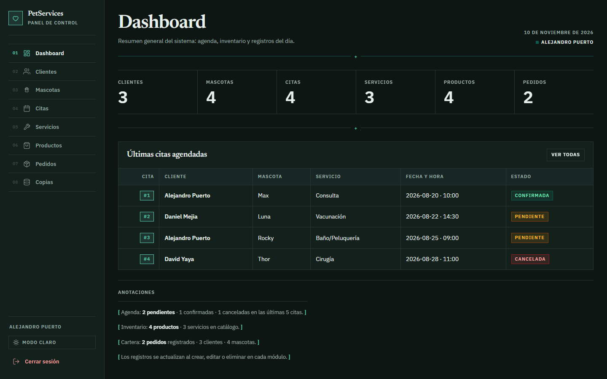
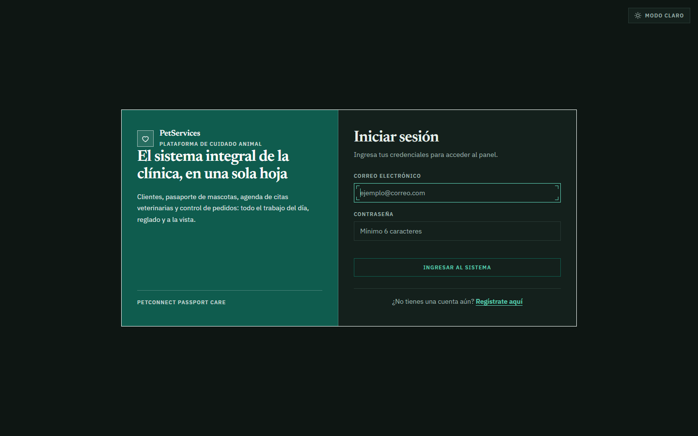
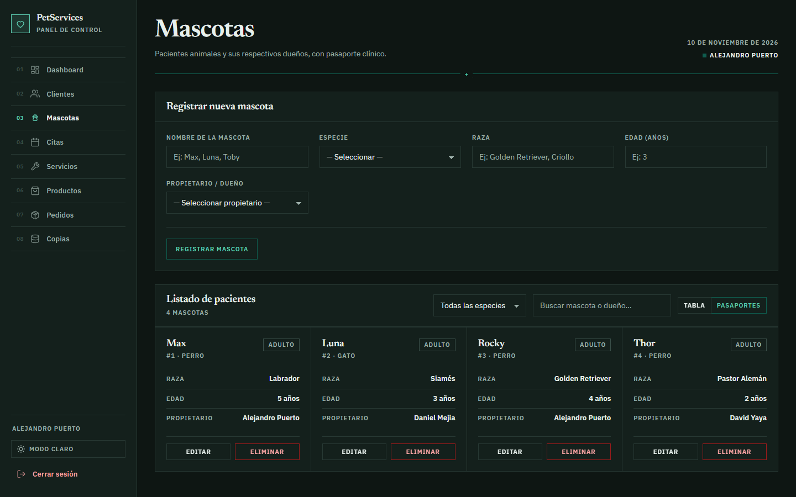
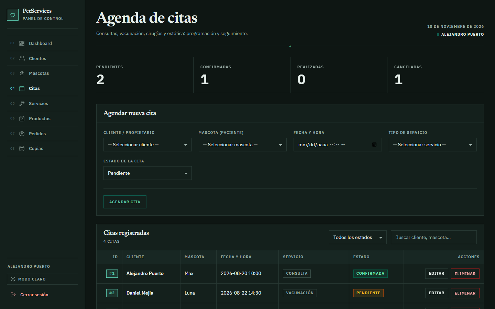
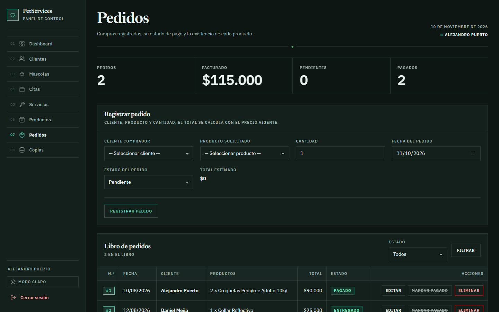
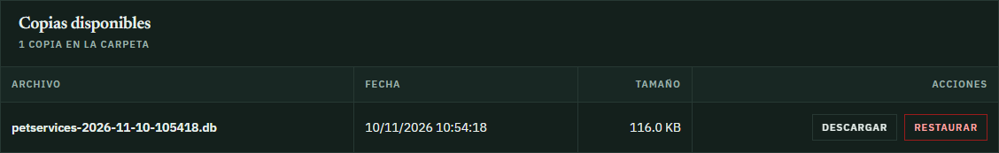

# 🐾 PetServices

**Gestión para clínica veterinaria y petshop**: panel web y API REST JSON sobre las mismas
entidades. Hecho con **Java 11 + Servlets 4.0 + JSP** y empaquetado como `petservices.war`
para **Apache Tomcat 9**, con base de datos **SQLite** embebida.

[](https://github.com/davidyayafx/petservices/actions/workflows/ci.yml)
[](https://github.com/davidyayafx/petservices/releases)
[](https://openjdk.org/projects/jdk/11/)
[](https://tomcat.apache.org/download-90.cgi)
[](https://sqlite.org/)
[](#pruebas-y-verificación)



---

## Tabla de contenidos

- [Qué es](#qué-es)
- [Capturas](#capturas)
- [Funcionalidades](#funcionalidades)
- [Cómo funciona](#cómo-funciona)
- [Stack técnico](#stack-técnico)
- [Inicio rápido](#inicio-rápido)
- [API REST](#api-rest)
- [Estructura del proyecto](#estructura-del-proyecto)
- [Base de datos y copias de seguridad](#base-de-datos-y-copias-de-seguridad)
- [Pruebas y verificación](#pruebas-y-verificación)
- [Estado del proyecto](#estado-del-proyecto)
- [Hoja de ruta](#hoja-de-ruta)
- [Sobre este proyecto](#sobre-este-proyecto)
- [Documentación](#documentación)

---

## Qué es

Un sistema de gestión pensado para el día a día de una clínica veterinaria o un petshop:
registrar clientes y sus mascotas, agendar citas, llevar el catálogo de servicios y
productos, y controlar los pedidos con su stock.

Tiene **dos frentes sobre el mismo modelo de datos**:

| Frente | Público | Tecnología |
|---|---|---|
| **Panel web** | Personal de la clínica (sesión con login) | JSP renderizado en servidor + Servlets |
| **API REST** | Integraciones y pruebas automatizadas | Servlets + JSON (Gson), autenticación con token |

Todo se apoya en una **base de datos local SQLite**: la aplicación no pierde nada al cerrar el
navegador, reiniciar Tomcat o apagar el equipo.

---

## Capturas

| Acceso | Mascotas (vista pasaporte) |
|---|---|
|  |  |

| Agenda de citas | Pedidos y stock |
|---|---|
|  |  |

**Copias de seguridad** (`/respaldos`): crear, descargar y restaurar la base con validación
de integridad.



---

## Funcionalidades

- **Autenticación**: registro, login y logout; sesión de 30 minutos y contraseñas con
  **PBKDF2-HMAC-SHA256** (sal por usuario).
- **Siete módulos CRUD**: clientes, mascotas, citas, servicios, productos, pedidos y
  establecimientos, con búsqueda y filtros en las vistas.
- **Agenda de citas** con estados canónicos (`Pendiente`, `Confirmada`, `Cancelada`,
  `Completada`) y validación de choques de horario.
- **Pedidos con stock transaccional**: descuenta al crear, ajusta al editar y devuelve al
  eliminar; si falta stock, la operación se revierte completa.
- **Copias de seguridad**: copia automática al arrancar y manual desde el panel, con
  `VACUUM INTO`, retención configurable y restauración validada (cabecera SQLite,
  `integrity_check`, versión de esquema).
- **Seguridad web**: token CSRF en todos los POST del panel, borrados por POST, cabeceras de
  seguridad (CSP) y respuestas de error homogéneas.
- **API REST** con token Bearer, códigos de estado correctos y sin exponer contraseñas.
- **Vistas tolerantes a fallos**: páginas 404, 500 y 503 (esta última cuando la base no está
  disponible).

---

## Cómo funciona

```
┌──────────────┐   HTTP    ┌──────────────────────────────────────────────┐
│  Navegador   │ ────────► │  Apache Tomcat 9  ·  contexto /petservices   │
└──────────────┘           │                                              │
                           │   SecurityHeadersFilter ── CSP y cabeceras   │
                           │            │                                 │
                           │   ┌────────┴─────────┐                       │
                           │   │                  │                       │
                           │   JSP + Servlets     *ApiServlet  +ApiAuthFilter
                           │   (panel web)        (JSON con Bearer)       │
                           │   │                  │                       │
                           │   └────────┬─────────┘                       │
                           │        Controller / Service                  │
                           │            │                                 │
                           │        DAO (JDBC, PreparedStatement)         │
                           └────────────┼─────────────────────────────────┘
                                        │
                              ┌─────────▼──────────┐
                              │ SQLite (archivo)   │  datos/petservices.db
                              │ + copias .db       │  datos/copias/
                              └────────────────────┘
```

Decisiones de diseño que vale la pena destacar:

- **Sin frameworks**: Servlets y JSP puros, para entender qué hace el contenedor por dentro.
- **DAO detrás de interfaces** (`I*DAO`): el resto del código no sabe que hay SQLite debajo.
- **Una sola puerta a la base**: `BaseDatos` resuelve la ruta, abre conexiones y bloquea
  durante una restauración.
- **Migraciones versionadas** (`V1__esquema_inicial.sql` + `Migrador`): el esquema evoluciona
  sin scripts manuales.

---

## Stack técnico

| Capa | Tecnología |
|---|---|
| Lenguaje | Java 11 (`source/target 11`, probado con JDK 21 y 26) |
| Web | Servlets 4.0 (`javax.servlet`) + JSP 2.3, sin Spring ni JSTL |
| Servidor | Apache Tomcat 9 |
| JSON | Gson 2.10.1 |
| Base de datos | SQLite (`org.xerial:sqlite-jdbc` 3.46.1.3) |
| Build | Maven 3.9 (WAR `petservices.war`, ~14,8 MB) |
| Pruebas | JUnit 5 (56 casos) + script de humo de API (14 casos) |
| CI | GitHub Actions (`.github/workflows/ci.yml`) |

---

## Inicio rápido

### Opción 1 · Paquete portable (sin compilar nada)

Solo necesitas **Java 11+**.

1. Descarga **[PetServices-Portable-v1.1.0.zip](https://github.com/davidyayafx/petservices/releases/download/v1.1.0/PetServices-Portable-v1.1.0.zip)** (26,7 MB) desde el
   [release v1.1.0](https://github.com/davidyayafx/petservices/releases/tag/v1.1.0).
2. Descomprímelo en una carpeta propia.
3. Doble clic en **`Iniciar-PetServices.bat`** (el lanzador avisa si falta Java).
4. Se abre el navegador en `http://localhost:8080/petservices/login`.
5. Para cerrar: **`Detener-PetServices.bat`**.

El paquete incluye Tomcat 9 portátil, el WAR compilado, el código fuente y un `LEEME.txt`.

### Opción 2 · Desde el código

Requisitos: JDK 11+, Maven 3.9 y Tomcat 9. En este repositorio Maven y Tomcat están en
`herramientas/`, junto al proyecto.

```powershell
# Compilar y empaquetar (primera vez: necesita internet para bajar sqlite-jdbc)
cd petservices
..\herramientas\apache-maven\bin\mvn.cmd -o clean package

# Desplegar en el Tomcat portátil y arrancar
cd ..
powershell -ExecutionPolicy Bypass -File .\scripts\desplegar_tomcat.ps1

# Alternativa con el lanzador (compila solo si cambió algo y abre el navegador)
powershell -ExecutionPolicy Bypass -File .\scripts\iniciar_petservices.ps1
powershell -ExecutionPolicy Bypass -File .\scripts\detener_petservices.ps1
```

> `-o` compila en modo offline. La primera compilación necesita conexión para descargar
> `sqlite-jdbc`; después queda en `~/.m2`.
>
> Los `.bat` `desplegar.bat` e `iniciar-local.bat` asumen `mvn` en el `PATH`; en este equipo no
> está, así que conviene usar los scripts de PowerShell.

También se puede probar sin Tomcat externo, con el plugin embebido:

```powershell
..\herramientas\apache-maven\bin\mvn.cmd tomcat7:run -Dapp.port=8081
# http://localhost:8081/petservices/login
```

### Rutas del panel

Bajo `http://localhost:8080/petservices/…`:

| Ruta | Qué hace |
|---|---|
| `/` | Redirige a login o al dashboard si hay sesión |
| `/login` · `/registro` | Acceso y creación de cuenta |
| `/dashboard` | KPIs y últimas 5 citas |
| `/clientes` · `/mascotas` · `/citas` | CRUD con sesión |
| `/servicios` · `/productos` · `/pedidos` | CRUD con sesión |
| `/respaldos` | Crear, descargar y restaurar copias de seguridad |
| `/logout` | Cerrar sesión |

### Cuentas de prueba

Se cargan una sola vez en `datos/petservices.db` y después se conservan:

| Correo | Contraseña |
|---|---|
| `alejandro@gmail.com` | `123456` |
| `daniel@gmail.com` | `123456` |
| `david@gmail.com` | `123456` |

> También puedes crear una cuenta desde `/registro` o con `POST /api/clientes`.

---

## API REST

| Recurso | Ruta base |
|---|---|
| Autenticación | `/api/auth/login` · `/api/auth/logout` |
| Clientes | `/api/clientes` |
| Mascotas | `/api/mascotas` |
| Establecimientos | `/api/establecimientos` |
| Servicios | `/api/servicios` |
| Citas | `/api/citas` |
| Productos | `/api/productos` |
| Pedidos | `/api/pedidos` |

Métodos, cuerpos, filtros y códigos de estado en el contrato completo:
**[`DOCUMENTACION_API.md`](./DOCUMENTACION_API.md)**. También hay una colección de Postman en
[`postman/`](./postman/).

Reglas del contrato vigente:

- `POST /api/auth/login` devuelve un `token`; el resto de rutas exigen
  `Authorization: Bearer <token>` (8 h de vigencia, en memoria).
- Las respuestas **nunca** incluyen `contrasena`.
- Cuerpo vacío o JSON mal formado → `400`; recurso inexistente → `404`; duplicados → `409`.
- Un `PUT` parcial conserva los campos no enviados.

### Petición de ejemplo (PowerShell)

```powershell
$body  = @{ correo = 'alejandro@gmail.com'; contrasena = '123456' } | ConvertTo-Json
$token = (Invoke-RestMethod -Method Post -Uri 'http://localhost:8080/petservices/api/auth/login' `
          -Body $body -ContentType 'application/json').token

Invoke-RestMethod -Uri 'http://localhost:8080/petservices/api/mascotas' `
  -Headers @{ Authorization = "Bearer $token" }
```

Para probar los 14 casos de humo contra una instancia arrancada:

```powershell
powershell -ExecutionPolicy Bypass -File ..\scripts\probar_api.ps1
```

---

## Estructura del proyecto

```
petservices/
├── pom.xml                     ← Maven: WAR, dependencias, plugin Tomcat
├── DOCUMENTACION_API.md        ← contrato de la API (única copia vigente)
├── README.md                   ← este archivo
├── docs/img/                   ← capturas usadas en el README
├── postman/                    ← colección y entorno de Postman
└── src/
    ├── main/
    │   ├── java/com/petservices/
    │   │   ├── modelo/         ← JavaBeans del dominio (8 clases)
    │   │   ├── db/             ← conexión, migraciones, semillas, respaldos, errores
    │   │   ├── dao/            ← 7 DAO + 7 interfaces I*DAO (JDBC sobre SQLite)
    │   │   ├── service/        ← PedidoService (pedido + stock transaccional)
    │   │   ├── servlet/        ← Registro, Login, Logout, Cliente
    │   │   ├── controller/     ← BaseModuleServlet + Dashboard + CRUD + RespaldoServlet
    │   │   ├── api/            ← 8 servlets REST + ApiAuthFilter + util/TokenStore
    │   │   ├── filter/         ← SecurityHeadersFilter (CSP)
    │   │   └── util/           ← PasswordUtil (PBKDF2) y CsrfUtil
    │   ├── resources/com/petservices/db/migraciones/
    │   │   └── V1__esquema_inicial.sql
    │   └── webapp/
    │       ├── index.jsp
    │       ├── vistas/         ← login, registro, dashboard, 7 CRUD, respaldos, error404/500/503
    │       ├── css/app.css
    │       └── WEB-INF/
    │           ├── web.xml     ← welcome-file, sesión 30 min, páginas de error
    │           └── jsp/        ← head, sidebar, scripts, util, modal-confirmacion
    └── test/java/com/petservices/
        ├── api/  dao/  db/  modelo/  util/   ← 13 clases de prueba (56 casos)
```

---

## Base de datos y copias de seguridad

- Motor **SQLite** embebido; archivo único en `../datos/petservices.db` (fuera del WAR y del
  repositorio, ignorado por `.gitignore`).
- Ruta configurable con `-Dpetservices.db.path` o la variable de entorno `PETSERVICES_DB`.
- Módulos persistentes: clientes, mascotas, citas, servicios, productos, pedidos (con detalle)
  y establecimientos.
- **Copias** en `../datos/copias/` con `VACUUM INTO`: automática al arrancar, antes de
  restaurar y manual desde `/respaldos`. Retención de 10 por defecto
  (`petservices.copias.retencion`).
- **Restauración** en caliente con validación previa; si Windows bloquea el archivo, se detiene
  el servidor y se usa `scripts/restaurar_bd.ps1`.
- Las pruebas usan **siempre** una base aislada en `target/test-db/`: nunca tocan la real.

Esquema, migraciones y solución de problemas: [`../DOCUMENTACION/BASE_DE_DATOS.md`](../DOCUMENTACION/BASE_DE_DATOS.md).

---

## Pruebas y verificación

```powershell
# Todo: build + 56 pruebas JUnit + despliegue + 14 casos de API + vistas
powershell -ExecutionPolicy Bypass -File ..\scripts\verificar_todo.ps1 -Offline

# Por separado
..\herramientas\apache-maven\bin\mvn.cmd -o clean package
powershell -ExecutionPolicy Bypass -File ..\scripts\probar_api.ps1
```

| Comprobación | Resultado |
|---|---|
| Build + JUnit | **56/56** en verde; WAR de 14,8 MB |
| API REST | **14/14** casos de humo conformes |
| Rutas del panel | **14/14** HTTP 200 sin errores de JSP |
| Persistencia tras reinicio de Tomcat | los 7 módulos conservan sus registros |
| Copia → cambio → restauración | el cambio posterior desaparece y vuelve el estado respaldado |
| Integridad SQLite | `integrity_check = ok`, `foreign_key_check` vacío |
| CI | compila, prueba y publica el WAR en cada push a `main` |

El detalle histórico está en [`../DOCUMENTACION/CAMBIOS_REALIZADOS.md`](../DOCUMENTACION/CAMBIOS_REALIZADOS.md).

---

## Estado del proyecto

Versión actual: **1.1.0** (persistencia completa en SQLite). Es un proyecto **funcional y
verificado**, no una maqueta, pero sigue en evolución.

**Lo que está probado**

- CRUD de los siete módulos por panel web y por API.
- Persistencia real y copias de seguridad con restauración.
- Autenticación con token, contraseñas hasheadas y CSRF en el panel.
- 56 pruebas unitarias y 14 casos de humo de API en verde.

**Limitaciones conocidas** (asumidas, no ocultas)

| Limitación | Detalle |
|---|---|
| Sin HTTPS | Pensado para `localhost`; detrás de un proxy con TLS requiere configuración extra |
| Token en memoria | `TokenStore` guarda los tokens en el proceso: un reinicio los invalida |
| Sin licencia | Todavía no hay archivo `LICENSE`; el código es visible, pero no está formalmente licenciado |
| Sin linter | La verificación es el build + las pruebas + `verificar_todo.ps1` |
| API sin paginación | Los listados devuelven todo; con volumen alto habría que paginar |
| Windows-first | Los scripts de automatización son PowerShell |

---

## Hoja de ruta

Ideas anotadas, sin fecha comprometida:

- [ ] Archivo `LICENSE` y guía de contribución.
- [ ] Configuración por variables de entorno (incluido un secreto de firma) y ejemplo con HTTPS.
- [ ] Paginación y búsqueda en la API.
- [ ] Pruebas de extremo a extremo de las vistas (Playwright/Selenium), hoy cubiertas a mano.
- [ ] Despliegue en contenedor (Dockerfile + volumen para `datos/`).
- [ ] Roles de usuario y registro de auditoría.

---

## Sobre este proyecto

PetServices es **uno de mis primeros proyectos de desarrollo web**, hecho como parte de mi
formación en el **SENA (ficha 3186628)**.

Empecé sin experiencia previa en Java web y lo construí **sin frameworks**: Servlets, JSP y
JDBC a mano. Esa decisión hace que el código sea más largo que con Spring, pero también deja
ver con claridad qué hace el contenedor, cómo viaja una petición y dónde se rompe algo.

Lo fui iterando por fases: primero los CRUD y la API, después la seguridad (PBKDF2, tokens
Bearer, CSRF, cabeceras), luego la persistencia real en SQLite y por último las copias de
seguridad y la restauración. Cada fase, con sus errores y correcciones, está documentada en
[`CAMBIOS_REALIZADOS.md`](../DOCUMENTACION/CAMBIOS_REALIZADOS.md).

Lo comparto como lo que es: una base honesta de lo que sé hacer hoy y un punto de partida para
lo que viene. Comentarios, correcciones y sugerencias son bienvenidos.

---

## Documentación

| Documento | Contenido |
|---|---|
| [`DOCUMENTACION_API.md`](./DOCUMENTACION_API.md) | Contrato REST: métodos, cuerpos, códigos y ejemplos |
| [`../DOCUMENTACION/ARQUITECTURA.md`](../DOCUMENTACION/ARQUITECTURA.md) | Capas, paquetes y flujo de una petición |
| [`../DOCUMENTACION/BASE_DE_DATOS.md`](../DOCUMENTACION/BASE_DE_DATOS.md) | Esquema SQLite, migraciones y respaldos |
| [`../DOCUMENTACION/INSTALACION.md`](../DOCUMENTACION/INSTALACION.md) | Build, despliegue y solución de problemas |
| [`../DOCUMENTACION/FUNCIONAMIENTO.md`](../DOCUMENTACION/FUNCIONAMIENTO.md) | Módulos, reglas de negocio y datos semilla |
| [`../DOCUMENTACION/CAMBIOS_REALIZADOS.md`](../DOCUMENTACION/CAMBIOS_REALIZADOS.md) | Historial de fases y verificaciones |

---

## Datos del proyecto

- **Sistema:** PetServices
- **Ficha SENA:** 3186628
- **Competencia:** Módulos de software codificados y probados
- **Evidencias:** GA7-220501096-AA2-EV02 · GA7-220501096-AA5-EV03 · GA10-220501097-AA7-EV01 · GA10-220501097-AA10-EV01
- **Repositorio:** <https://github.com/davidyayafx/petservices>
- **Autor:** David Yaya ([@davidyayafx](https://github.com/davidyayafx))
